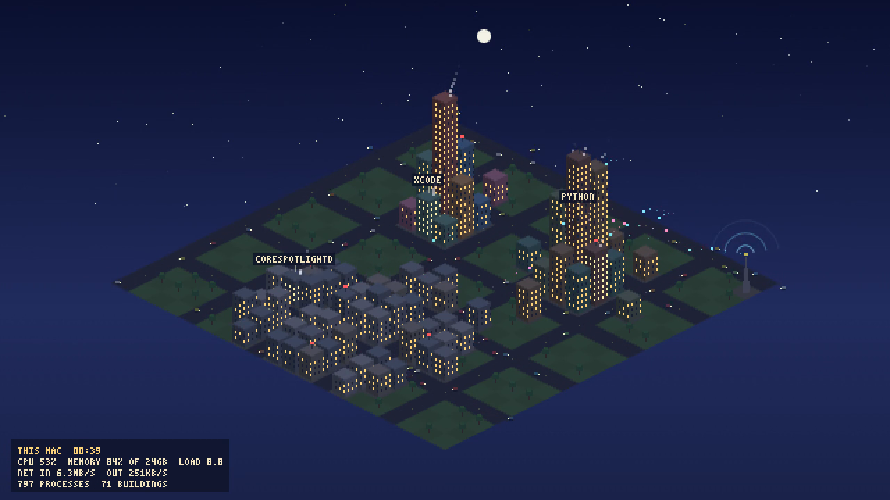

# SimMac

This Mac, drawn as a living isometric pixel city in the browser, from real system data.



- **Buildings are apps.** Every process is grouped under the app it belongs to (all of Chrome's helper processes live in the Google Chrome building). Height follows the app's memory. Windows light up with the app's CPU use, and busy apps smoke.
- **Districts:** apps in one quarter, macOS system processes in another, and a workshop quarter for developer tools and anything else on the command line.
- **Cars are processes.** About one car per twelve processes, and they drive faster as total CPU rises.
- **The tower is the network.** Cyan arcs carry received bytes to buildings and pink arcs carry sent bytes back, at a rate that grows with traffic. The rings grow with total throughput.
- **The sky follows your clock:** sun, stars, dusk and dawn. The roads pulse outward from the center with the load average.
- **Agent processes** (names containing claude, codex, agent or intent) get a blinking red beacon on the roof.
- The HUD shows the clock, CPU, memory, load, network in and out, and process and building counts.

## Run it

Python 3.9 or newer on macOS. No packages to install.

```sh
python3 -m simmac.server
# open http://127.0.0.1:8817/
```

The server binds to 127.0.0.1 only. The page polls `/api/snapshot` once a second.

Page options:
- `?hour=13` pins the sky to an hour.
- `?cycle=20` runs a full day of sky every 20 seconds. The data stays live.
- `?record=20` records 20 seconds of the canvas and uploads it to the server.

To hide an app's name, set `SIMMAC_REDACT=word1,word2` before starting. Any app whose name contains one of the words is shown as "private".

## Where the data comes from

Only built-in macOS commands, run once a second at most:

| Reading | Command | Notes |
|---|---|---|
| Processes, CPU, memory per process | `ps -axo pid,ppid,pcpu,pmem,rss,comm` | `pcpu` is ps's decaying average, in percent of one core |
| Memory used | `vm_stat`, `sysctl hw.memsize` | active + wired + compressed pages, close to Activity Monitor's "memory used" |
| Network | `netstat -ib` | bytes per second from counter deltas; loopback, tunnels, bridges and unused links are skipped so traffic isn't counted twice |
| Load | `sysctl vm.loadavg` | |

Only app names and numbers reach the browser, never command lines, paths or arguments.

## Record a clip

```sh
python3 scripts/record_clip.py --seconds 20 --out media
python3 scripts/record_clip.py --seconds 20 --out media --query cycle=20
```

This opens the page in headless Chrome in record mode, waits for the clip, then converts it to MP4 with ffmpeg and saves a poster frame. It needs Google Chrome and ffmpeg.

Two clips recorded on this Mac at about 00:40 on Oct 21, 2026 are in `media/`:
- `simmac-20s.mp4`: 20.0 s, 1280x720, live data at the real time (night).
- `simmac-20s-cycle20.mp4`: 19.9 s, the same live data with the sky sped up to a full day in 20 seconds. **The sky in this clip is a time-lapse; the numbers are real.**

**Frame rate, honestly:** headless Chrome captured 284 frames (live clip) and 349 frames (cycle clip) in 20 seconds, so about 14 to 17 frames a second. The MP4s are encoded at 30 fps by repeating frames. A visible browser window draws more smoothly. I didn't measure its frame rate.

## Tests

```sh
python3 -m unittest discover -s tests -t .
```

There are 21 tests:
- **Parsers:** `ps` (including bad lines, app-bundle grouping and process titles), `vm_stat`, `netstat -ib` (address rows not double-counted, skipped interfaces) and the load average.
- **City model:** grouping, sorting, redaction, network rates, counter resets, and CPU and memory fractions.
- **Server:** snapshot JSON, static page, clip upload, render reports, error codes, and localhost-only binding.
- **Render smoke tests** (two), in headless Chrome against a fake Mac with 12 apps:
  - The page must report drawing 60 frames with all 12 apps as buildings and at least 6 cars, and the canvas image it sends back must be 16:9 with more than 30 distinct colors.
  - The page must keep drawing when animation frames are turned off (`?noraf`). This is the real failure found while building: Chrome on macOS sometimes can't start its display link in a headless window (`CVDisplayLinkCreateWithCGDisplay failed`), so animation frames never arrive. The page now also schedules each frame on a 40 ms timer. With the timer removed, this test fails.
  - Both are skipped if Chrome isn't installed.

Ten full runs in a row passed here, taking 13 to 42 seconds each, mostly the Chrome tests. The machine was under heavy load from other jobs at the time.

## Limits

- macOS only. The parsers read macOS command output.
- At most 60 buildings: the 60 apps using the most memory. An app that drops out stays for 10 seconds, then its building sinks.
- CPU per app comes from `ps`, which averages over time, so spikes show up smoothed.
- It reads `ps` once a second. On a busy machine one read took up to 1.2 s here, so updates can lag.
- The city layout is fixed at 20 by 20 tiles. Lots are assigned when an app first appears, so a building keeps its place.
- Not tested in browsers other than Chrome.

## Lineage

The idea comes from [perch](https://github.com/abhaymettu/perch), a menu bar app that watches what runs on this Mac. SimMac shares no code with it; it reads the same kind of data straight from `ps`.
