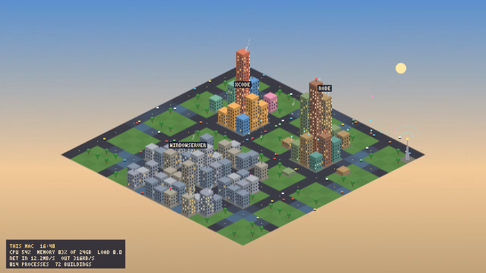

# SimMac

This Mac, drawn as a living isometric pixel city in the browser, from real system data.

[](media/simmac-20s-cycle20.mp4)

*The sky in this clip is sped up to a day in 20 seconds; the readings are live.*

Every app is a building, every few processes a car, network traffic is light arcing from a tower. Every reading comes from live system data; nothing is mocked.

- **Buildings are apps.** Every process is grouped under the app it belongs to. Height follows the app's memory, windows light up with its CPU use, and busy apps smoke.
- **Cars are processes.** About one per twelve, driving faster as total CPU rises.
- **Districts:** apps in one quarter, macOS system processes in another, and a workshop quarter for developer tools and anything else on the command line.
- **The tower is the network.** Cyan arcs carry received bytes, pink arcs carry sent bytes.
- **The sky follows your clock.** Sun, stars, dusk and dawn. Roads pulse with the load average.
- **Agent processes** (claude, codex, agent, intent) get a blinking red beacon on the roof.

## Run it

Python 3.9 or newer on macOS. No packages to install.

```sh
python3 -m simmac.server
# open http://127.0.0.1:8817/
```

The server binds to 127.0.0.1 only. The page polls `/api/snapshot` once a second.

Page options: `?hour=13` pins the sky, `?cycle=20` runs a full day of sky every 20 seconds (the data stays live), `?record=20` records 20 seconds of the canvas.

Set `SIMMAC_REDACT=word1,word2` to show matching app names as "private".

## Where the data comes from

Only built-in macOS commands, run once a second at most:

| Reading | Command |
|---|---|
| Processes, CPU, memory | `ps -axo pid,ppid,pcpu,pmem,rss,comm` |
| Memory used | `vm_stat`, `sysctl hw.memsize` |
| Network | `netstat -ib` (loopback, tunnels and unused links skipped, so nothing counts twice) |
| Load | `sysctl vm.loadavg` |

Only app names and numbers reach the browser, never command lines, paths or arguments.

## Record a clip

```sh
python3 scripts/record_clip.py --seconds 20 --out media
```

Headless Chrome captures the page and ffmpeg makes the MP4. The clips in `media/` were recorded on this Mac at about 00:40 on Oct 21, 2026: `simmac-20s.mp4` is live data at night, `simmac-20s-cycle20.mp4` is the same live data with the sky sped up to a day in 20 seconds. Frame rate, honestly: headless Chrome captured about 14 to 17 frames a second, and the MP4s repeat frames to reach 30. A visible browser window draws more smoothly.

## Tests

```sh
python3 -m unittest discover -s tests -t .
```

22 tests: parsers (including malformed `ps` lines and skipped interfaces), the city model, the server, and two render smoke tests in headless Chrome. One smoke test exists because of a real failure found while building: Chrome on macOS sometimes cannot start its display link in a headless window, so animation frames never arrive. The page now also schedules frames on a 40 ms timer. Ten full runs passed in a row here, on a machine under heavy load.

## Limits

- macOS only; tested in Chrome only.
- At most 60 live buildings (the 60 biggest apps by memory). One that drops out stays for 10 seconds, then its building sinks.
- CPU per app comes from `ps`, a decaying average, so spikes show up smoothed. On a busy machine one `ps` read took 1.2 s here, so updates can lag.
- The city is a fixed 20 by 20 tiles; a building keeps its lot once assigned.

## Lineage

The idea comes from [perch](https://github.com/abhaymettu/perch), a menu bar app that watches what runs on this Mac. SimMac shares no code with it.
